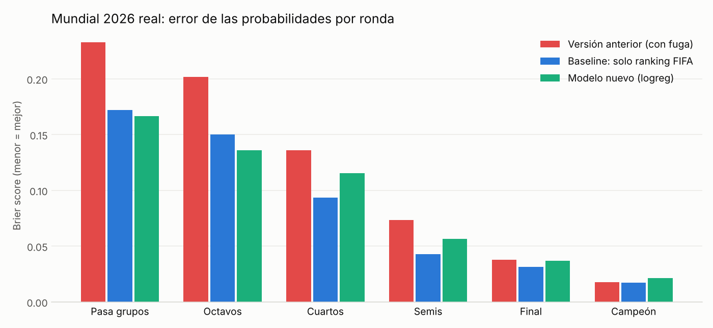

# WorldCup2026-ML

Modelo de partido + simulación Monte Carlo del Mundial 2026 con el **cuadro oficial de FIFA**, validado sin fuga de datos y evaluado contra el torneo real (España campeona, 1-0 a Argentina en la prórroga).

## Resultados honestos

### Validación walk-forward (Mundiales 1998–2022, 448 partidos fuera de muestra)

| Modelo | Log loss ↓ | RPS ↓ | Acierto | AUC (victoria) |
|---|---|---|---|---|
| **Regresión logística, todas las features** (seleccionado) | **0.983** | **0.200** | 53.8% | 0.730 |
| Gradient boosting regularizado | 0.992 | 0.203 | 52.7% | 0.708 |
| Baseline: solo ranking FIFA | 1.016 | 0.212 | 53.4% | 0.695 |
| Baseline: solo Elo | 1.017 | 0.212 | 52.0% | 0.684 |
| Frecuencias (sin mirar equipos) | 1.079 | 0.236 | 33.0% | 0.514 |

Objetivo de 3 clases (gana / empata / pierde). El acierto se compara contra 33% (azar con 3 clases).

### Test final: Mundial 2026 real (nunca usado para elegir modelo)

| Versión | Brier medio por ronda ↓ | Eliminatorias acertadas (31) | Puesto del campeón (España) | Puesto del subcampeón (Argentina) |
|---|---|---|---|---|
| Versión anterior (con fuga) | 0.117 | – | 1.º | **45.º** |
| **Baseline solo ranking FIFA** | **0.085** | **25 (81%)** | 2.º | 3.º |
| Modelo nuevo | 0.089 | 19 (61%) | 9.º | 4.º |

**Lectura:** el modelo nuevo mejora al baseline en la validación histórica, pero **no en 2026**. Sobrevaloró a los anfitriones (México y EE. UU. con ~24% de llegar a la final; ambos cayeron en octavos) y a la tradición mundialista frente al nivel actual (España, campeona de la Euro 2024, tenía un Elo mundialista mediocre). Un solo torneo son 31 eliminatorias, así que es evidencia, no veredicto; pero apunta a dos mejoras concretas (ver *Próximos pasos*).



## Qué se corrigió respecto a la versión anterior

1. **Fuga de datos:** los goles del propio partido eran variable de entrada (63% de la importancia). En 2026 se rellenaban con 0, lo que el modelo leía como "perdió". Ahora el resultado solo se usa como etiqueta.
2. **`is_home` eliminado:** solo indicaba qué equipo aparecía primero en la tabla. El modelo es ahora simétrico: cada partido se entrena desde las dos ópticas y P(A gana) = P(B pierde) por construcción.
3. **Ranking falso antes de 1994:** en vez de poner rank = 75 a todos, las diferencias de ranking valen 0 (= "sin información") y el Elo cubre esa época.
4. **Cuadro del torneo:** la separación "grupos A–F a la izquierda, G–L a la derecha" no existe. El cuadro de FIFA mezcla grupos (España, grupo H, y Francia, grupo I, se cruzaron en semis). Con la versión anterior una final España–Argentina era imposible. Ahora se usa el cuadro oficial (partidos 73–104) y la asignación de mejores terceros por combinación.
5. **Integración de nombres:** "United States" (partidos) ≠ "USA" (ranking/grupos) hacía que EE. UU. no tuviera ni ranking ni historial. Ahora hay un mapa canónico y sucesores históricos (West Germany → Germany, Zaire → Congo DR...).
6. **Datos corruptos en el ranking:** en dic-2025 y abr-2026 Corea del Sur aparece como "Korea DPR" (puesto 25) y hay otros nombres duplicados. Se reparan por continuidad de puntos.
7. **Puntos FIFA comparables:** la escala cambió en 1999, 2006 y 2018; se usan puntos normalizados (z-score) por fecha de publicación.
8. **Empates:** el modelo predice P(empate) en lugar de una "zona de empate" fija. En eliminatoria, empate → penales 50/50.

## Features (todas conocidas antes del torneo, como diferencia A − B)

| Feature | Lógica futbolística |
|---|---|
| `d_elo` | Fuerza acumulada con margen de goles y regresión a la media entre torneos |
| `d_points_z` | Nivel actual según FIFA, comparable entre épocas |
| `d_momentum` | Cambio de puntos FIFA en los 12 meses previos (llega en alza o en baja) |
| `d_hist_stage`, `d_recent_stage` | Ronda media alcanzada, total y en los 2 últimos Mundiales |
| `d_experience` | log(1 + Mundiales jugados) |
| `d_host` | Anfitrión |
| `d_home_conf` | Juega en su confederación (Europa rinde peor en América y viceversa) |

## Estructura

```
WorldCup2026-ML/
├── main.py                  # CLI: build | train | simulate | evaluate | all
├── src/wc/
│   ├── config.py            # rutas, fechas, features, hiperparámetros
│   ├── data.py              # carga, nombres canónicos, reparación del ranking
│   ├── features.py          # Elo, snapshots pre-torneo, features de partido
│   ├── model.py             # candidatos, walk-forward, métricas, selección
│   ├── bracket.py           # cuadro oficial 2026 y asignación de terceros
│   ├── simulate.py          # Monte Carlo
│   ├── evaluate.py          # comparación con el Mundial real
│   ├── export.py            # JSON para la futura web/API
│   ├── plots.py
│   └── pipeline.py          # orquestación de pasos
├── data/raw/                # fuentes originales (no se modifican)
├── data/external/           # resultados reales 2026, salida de la versión anterior
├── data/processed/          # generado
├── models/                  # match_model.joblib, baseline_rank.joblib, model_card.json
├── outputs/                 # simulation_2026.csv, predictions_2026.json, plots/
└── tests/test_pipeline.py   # anti-fuga, cuadro, simetría, integración
```

## Uso

```bash
pip install -r requirements.txt
python main.py all              # ~25 s con 20.000 simulaciones
python -m pytest -q
```

`outputs/predictions_2026.json` está pensado para la web: metadatos del modelo, métricas, probabilidades por equipo y ronda, y la matriz de enfrentamientos (para un "simulador de partido" sin ejecutar Python).

## Limitaciones conocidas

- La fase de grupos no simula goles: los empates a puntos se desempatan por sorteo.
- Para combinaciones de terceros no registradas se usa una asignación válida según las reglas; puede diferir de la tabla del Anexo C de FIFA (la combinación real de 2026 sí está registrada).
- El ranking del CSV no tiene publicaciones entre jun-2024 y dic-2025, así que el momentum de 2026 compara contra jun-2024.

## Próximos pasos

1. **Elo con todos los partidos internacionales** (no solo Mundiales). Ya está implementado: basta con guardar el dataset público *International football results* (martj42, GitHub/Kaggle) como `data/raw/international_results.csv` y correr `python main.py all`. Es la mejora con más potencial: capta Eurocopas, Copas América y eliminatorias.
2. **Efecto anfitrión con tres sedes:** el coeficiente se aprendió de torneos con un único anfitrión; en 2026 se diluye. Opciones: estimarlo por partido jugado en casa o limitarlo.
3. Valor de mercado de la plantilla como feature de nivel actual.
